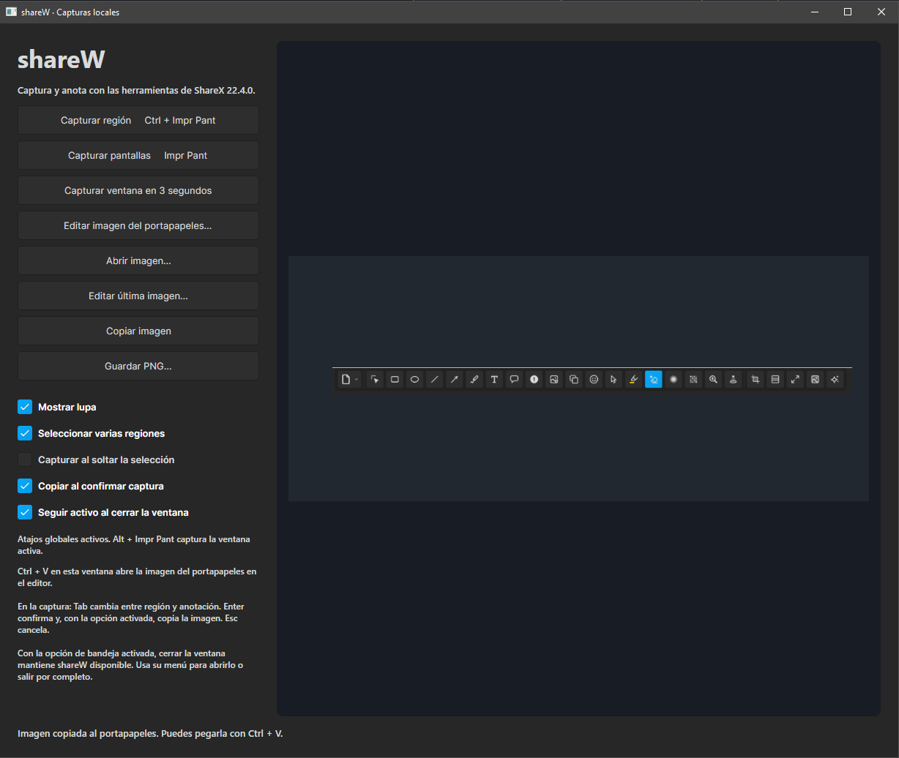

# shareW

A portable screenshot and image editor for **Windows x64**, based on [ShareX](https://github.com/ShareX/ShareX) 22.4.0. Capture and edit locally, with upload features removed.

[Documentación en español](README-ES.md)

## Download

1. Go to [Releases](../../releases).
2. Under **Assets**, download the **full Windows x64 portable ZIP**.
3. Extract the entire ZIP and run `shareW.exe`.

No installation or separate .NET installation is needed. Keep all included files together. For your first download, choose the full portable rather than an update ZIP or GitHub's **Source code** archives.

## Features

- Region, full-screen, and active-window capture.
- ShareX's capture toolbar and image editor: arrows, text, shapes, numbered steps, blur, pixelation, and more.
- Edit clipboard images without saving them first.
- Copy confirmed captures automatically and save images locally.
- System tray mode with global capture shortcuts.
- Upload destinations, URL image downloads, and automatic updates removed.

## Usage

- **Ctrl + Print Screen:** select and annotate a region.
- **Print Screen:** capture all screens.
- **Alt + Print Screen:** capture the active window.
- **Enter** during capture: confirm and copy. **Esc:** cancel.
- **Ctrl + V** in the main window: open the clipboard image in the editor.

Paste your finished capture into another app with **Ctrl + V**. You can also open saved images or save your edits from shareW.

Closing the window keeps shareW in the tray by default. Click its icon to reopen it; right-click → **Salir de shareW** to quit. Look under Windows' hidden-icons arrow (`^`) if needed. Automatic copying and tray mode can be disabled in the main window.

The main window currently uses Spanish labels. If a capture shortcut is already in use, use the on-screen buttons.

## Updating

Quit shareW from the tray before replacing files. Use the new full portable or a compatible update ZIP. Your preferences are kept in `%LOCALAPPDATA%\shareW\settings.json`.

## Credits and license

An independent derivative of ShareX, without affiliation or endorsement from its team. See [LICENSE](LICENSE) and [third-party notices](Licenses/). New code is GPL-3.0-or-later.

For build instructions and detailed notes, see [README-ES.md](README-ES.md), sorry it is in Spanish :).
